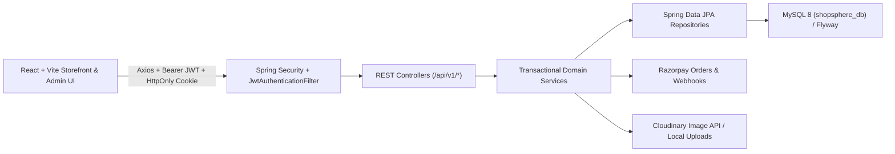
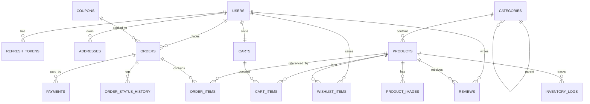
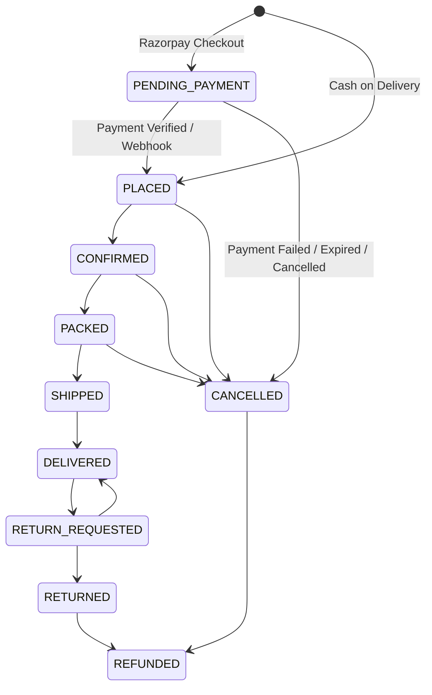

# ShopSphere System Architecture & Database Design

## 1. Modular Monolith Architecture

## 2. Database Entity-Relationship Diagram

## 3. Order State Machine

## 4. Key API Modules (`/api/v1`)

| Module | Base Path | Access |
|---|---|---|
| Auth | `/api/v1/auth` | Public (`/register`, `/login`, `/refresh`, `/logout`) |
| Users & Addresses | `/api/v1/users`, `/api/v1/addresses` | Authenticated (`CUSTOMER`, `ADMIN`) |
| Categories & Products | `/api/v1/categories`, `/api/v1/products` | Public GET, Admin write |
| Cart & Wishlist | `/api/v1/cart`, `/api/v1/wishlist` | Authenticated |
| Orders | `/api/v1/orders` | Customer-scoped |
| Payments & Webhooks | `/api/v1/payments` | Authenticated + Razorpay HMAC Webhook |
| Reviews & Newsletter | `/api/v1/reviews`, `/api/v1/newsletter` | Public GET / Subscribe, Auth write |
| Admin Console | `/api/v1/admin/**` | `ADMIN` role only |

Interactive API docs are exposed at `/swagger-ui.html` and `/v3/api-docs`.
